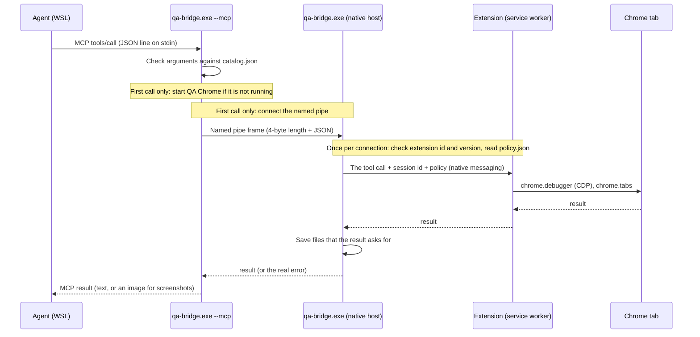

# Windows Chrome Bridge

Windows Chrome Bridge lets an AI agent that runs in WSL control a real Google Chrome on Windows.

It is for people who code in WSL with an agent such as Claude Code or Codex,
and want the agent to test web pages in the real Windows Chrome:
log in, click, type, upload and download files, take screenshots and videos, measure speed and memory, run JavaScript.

The agent sees an MCP server named `isolated_windows_qa` with `qa_*` tools: 21 by default, 25 in all.
The tools are made for agents: a page is read as a short text tree with refs, an action returns only what changed,
many steps fit in one call, and big output goes to a file.
Chrome runs with its own profile ("QA Chrome"), so the agent never touches your personal Chrome profile.
By default nothing takes the keyboard focus: you can keep working while the agent tests.

## Quick start

You need:

- Windows 10 or 11
- Google Chrome
- WSL 2 with Python 3.12 or newer (Ubuntu 24.04 in WSL has Python 3.12)

You do not need admin rights, Node.js or the .NET SDK.
The bridge is built with the C# compiler that is part of Windows.

In a WSL terminal:

```bash
git clone https://github.com/darkov19/windows-chrome-bridge.git
cd windows-chrome-bridge
python3 manage.py install
```

`install` asks before it adds the MCP server to Claude Code (`~/.claude.json`) or Codex (`~/.codex/config.toml`).
To answer yes without a prompt, add `--claude`, `--codex` or both.

Then restart your agent session and ask it, for example:
"Open http://localhost:5173 in Windows Chrome and check the login form."

Without git, download `windows-chrome-bridge-<version>.zip` from the
[releases page](https://github.com/darkov19/windows-chrome-bridge/releases). It holds a prebuilt `qa-bridge.exe`.

```bash
python3 -m zipfile -e windows-chrome-bridge-0.6.0.zip .
cd windows-chrome-bridge-0.6.0
python3 manage.py install
```

What `install` does:

1. It builds `qa-bridge.exe` (from a clone) or uses the prebuilt one (from a release zip).
2. It copies the bridge to `%LOCALAPPDATA%\windows-chrome-bridge\versions\<version>\`.
3. It registers the Chrome native host in `HKCU` (your user only).
4. It writes a default `bridge-config.json`, if there is none.
5. It runs a self-check: it starts QA Chrome with no window and asks the extension for its version. Chrome stops again about 10 s later.
6. It adds the MCP server to the agents you said yes to.

For any other MCP client, `install` prints the command, for example
`/mnt/c/Users/<you>/AppData/Local/windows-chrome-bridge/versions/<version>/qa-bridge.exe --mcp --wsl-distro Ubuntu --wsl-root /mnt/`.
A Windows program cannot see your WSL, so `--wsl-distro` (the distro the agent runs in) and `--wsl-root`
(where WSL mounts the Windows drives, `/mnt/` unless `/etc/wsl.conf` sets another `root`) tell it.

### Other commands

```bash
python3 manage.py doctor      # check everything and say how to fix a problem
python3 manage.py stop        # stop QA Chrome, if no agent session uses it
python3 manage.py install     # run it from a newer version to upgrade
python3 manage.py rollback    # go back to the version before
python3 manage.py uninstall   # remove everything install added
```

`uninstall` also removes the QA Chrome profile (its logins and cookies). Add `--keep-profile` to keep it.
A profile that the `profile` setting puts outside the install folder is never removed; `uninstall` says where it is.
A copy of `manage.py` is in the install folder, so you can run these after you delete the clone.

## How it works



One program, `qa-bridge.exe`, has three jobs:

| Job | Started by | What it does |
|---|---|---|
| MCP server (`--mcp`) | your agent, from WSL | Talks MCP on stdin and stdout. Checks arguments. Starts QA Chrome when needed. |
| Chrome keeper (`--chrome-keeper`) | the MCP server | Starts QA Chrome, loads the extension into it, and stays until Chrome exits. It also runs garbage collections for `qa_perf`. |
| Native host | Chrome | Connects the extension to the MCP server through a named pipe. Saves output files. |

The Chrome extension does the browser work with `chrome.debugger` (the Chrome DevTools Protocol, CDP),
`chrome.tabs` and `chrome.downloads`.

The MCP server speaks MCP 2024-11-05 to 2025-11-25, which start with the `initialize` handshake,
and MCP 2026-07-28, which has no handshake: each request names its version in `_meta`, and `server/discover`
tells a client what the server supports. It has tools only: no resources, prompts or logging.

Startup, step by step:

1. Your agent starts `qa-bridge.exe --mcp`. Nothing else happens yet.
2. At the first tool call, it looks for a Chrome process that uses the QA profile.
3. If there is none, it starts the keeper. The keeper starts Chrome with its own profile and no window.
4. The keeper loads the extension with the CDP command `Extensions.loadUnpacked`, over a pipe it shares with Chrome.
   Chrome exits when that pipe closes, so the keeper holds it until Chrome exits. No TCP port is opened.
5. The extension asks Chrome to start the native host. The native host checks that its parent is QA Chrome.
6. The native host opens a named pipe that only your Windows user can open. The MCP server connects to it.
7. When the agent disconnects, its tabs close. This also works when the agent kills the MCP server, as Claude Code does at exit.
   About 10 s after the last session left, the native host stops Chrome, if a session started it and no window is left.

### Sessions and tabs

Several agents can use QA Chrome at the same time. Each MCP connection is one session.

- A session acts only on tabs it has claimed. `qa_tabs` with `action: "new"` opens and claims a tab;
  `adopt` claims an existing one, for example a popup; `release` gives a tab up but leaves it open;
  `transfer` hands it to another session.
- `qa_session(name: "...")` names a session. The tab list shows each tab's owner by name.
- When a session ends, its claimed tabs close. A tab marked with `keep` stays open and becomes unclaimed.
- **All sessions share one profile.** They share cookies, logins, storage and history.
  If one agent logs out, the others are logged out too.
- At most 8 sessions at once and 32 tabs per session. Change this with `maxSessions` and `maxTabsPerSession`.
- About 10 s after the last session left, QA Chrome stops, if a session started it and no window is left.
  A QA Chrome you started yourself is never stopped this way. `python3 manage.py stop` stops it when no session uses it.

## Tools

Tools are in groups. `core` is always on. Choose the others with `toolGroups` in `bridge-config.json`.

| Group | On by default | Tools |
|---|---|---|
| core | always | `qa_session`, `qa_tabs`, `qa_navigate`, `qa_snapshot`, `qa_click`, `qa_fill`, `qa_type`, `qa_wait`, `qa_screenshot`, `qa_batch`, `qa_dialog`, `qa_hover`, `qa_scroll`, `qa_drag` |
| debug | yes | `qa_console`, `qa_network`, `qa_eval`, `qa_perf` |
| files | yes | `qa_upload`, `qa_downloads`, `qa_record` |
| device | no | `qa_emulate`, `qa_window` |
| data | no | `qa_storage` (localStorage, sessionStorage, cookies) |
| cdp | no | `qa_cdp` (one raw CDP command on a claimed tab) |

Why this default: QA work needs to read pages, act, see console errors, network calls and slow pages, and move files.
A video is often the proof a person wants, so `qa_record` is on too.
Emulation, storage and raw CDP are needed less often, and each tool costs the agent context in every session.
The default list is about 12,000 characters of tool descriptions; all groups are about 14,300.
Before 0.5.0 it was 42 tools and about 18,500 characters.

```json
{ "toolGroups": ["debug", "files", "device"] }
```

`"toolGroups": ["all"]` turns on every group, and `[]` leaves only core.
A new list applies to agent sessions that start after the change.
Tool groups save context; they are not a security limit. For limits, use `policy.json`.

The full guide for agents is [skill/SKILL.md](skill/SKILL.md).
For Claude Code, copy it to `~/.claude/skills/native-windows-chrome/SKILL.md`.

### How an agent works with a page

1. `qa_tabs(action: "new", url)` opens a tab, waits for the load, and returns the page as a tree:

   ```
   Page "Fixture app" http://127.0.0.1:18475/app
   - main [e20]
     - heading "Contact" [e21] [level=1]
     - form [e2]
       - textbox "Name" [e3]
       - textbox "Password" [e5] [password]: (hidden)
       - checkbox "I agree" [e7]
       - button "Send" [e8]
     - status [e41]: Not sent
   ```

   Each line is one element from the accessibility tree: role, name, state and value, and a ref like `e3`.
   Password fields are marked `[password]`, and their values are never shown.
   A field with no name shows its id, name or placeholder attribute, for example `textbox [e9] [id="user"]`.
2. Actions take refs: `qa_click(ref: "e8")`, `qa_fill(fields: [{ref: "e3", value: "Ann"}])`, `qa_type(ref, text, key)`.
   A `selector` (CSS, exactly one match) works too.
3. After an action, the tool waits until the page settles, then returns only the changes:

   ```
   Changes since the last read: 1 changed (~), 0 added (+), 0 removed (x).
   ~ - status [e41]: Thanks, Ann
   ```

4. `qa_batch` runs many steps on one tab in one call and returns one page read at the end.
   Each step gets the same checks as a single call, and the batch stops at the first failure.
   The steps have 30 s in all. A step that would start later does not run, and the result says which steps ran.

`qa_snapshot` reads the page again: the changes since the last read, or the whole tree with `full: true`.
It can also show only the controls (`interactive`), one subtree (`ref`), some levels (`depth`), one frame, or the lines
that contain a text (`search`). Frames are read inline, with refs such as `f1e6`.

Measured on the test pages (characters; tokens are about a quarter of that):

| | Before 0.5.0 | Now |
|---|---|---|
| Read the app page | 1,954 (`qa_snapshot`), 35,678 (`qa_accessibility`) | 790 (whole tree), 77 (read again, no change) |
| Read the login page | 1,885 and 20,770 | 670 (with the id of each field that has no name) |
| Open, read, fill two fields, click, check the result | 7 calls, 4,454 | 3 calls, about 1,400 (2 calls with `qa_batch`) |

### Big output: files

`qa_snapshot`, `qa_screenshot`, `qa_eval`, `qa_console`, `qa_network`, `qa_perf` (trace) and `qa_record` take `file: "name.ext"`.
The output is saved in `%LOCALAPPDATA%\windows-chrome-bridge\output\<session>\`, and the result gives the path
as WSL sees it (`/mnt/c/...`), so the agent can read the file directly. A file name is a name, not a path.
When QA Chrome starts, it removes session folders that did not change for 7 days (`keepOutputDays`).
`uninstall` removes the whole folder.

Screenshots are JPEG by default. `maxSize` limits the width and height in pixels.
An image that goes to the agent is at most 2000 px wide and high unless `maxSize` says otherwise, because models refuse
or shrink bigger images. The result then says the size before (`scaledFrom`). A screenshot saved with `file` keeps its full size.
A tab that is not the active tab of its window can be captured too. If Chrome does not paint it within 5 s,
the bridge shows it in its window for the capture, then shows the tab that was there before. The focus does not change.

### Videos: qa_record

`qa_record(action: "start", tabId, file: "login.mp4")` records a claimed tab. `qa_record(action: "stop")` saves the file
and returns its path, length, size and frame count. The file is an MP4 with H.264 video:
it plays on Windows with no extra software, and GitHub takes it in issues and pull requests.

- It works in headless and display mode, and for a tab that is not the active tab of its window.
  It never takes the focus and needs no click.
- Frames come from Chrome when the page changes (`Page.startScreencast`), at most `fps` a second (default 10).
  A page that does not change gets a frame each second. A tab that is not shown gets up to 5 frames a second from screenshots.
- `maxSize` limits width and height (default 1280 px). `maxSeconds` limits the length (default 60, at most 600).
- A recording stops by itself at `maxSeconds`, at 9.5 MB (under GitHub's 10 MB limit for videos on free plans),
  or when the tab closes. The file is saved at `stop`, or when the agent session ends.
- One recording per tab, at most 4 at once.

### Speed and memory: qa_perf

| Action | What it gives |
|---|---|
| `metrics` (default) | Load times (time to first byte, first contentful paint, DOMContentLoaded, load), LCP with its element, CLS, INP with the slowest interaction, long tasks, and the slowest resources (`limit`, default 5). Each vital has a rating: good, needs improvement or poor |
| `throttle` | `cpu` (a slow-down factor, for example 4) and `network` (`slow-3g`, `slow-4g`, `fast-4g`, `offline`, `none`). It stays on the tab until you change it. Reload, then measure |
| `memory` | JS heap after a full garbage collection, DOM nodes and event listeners of the tab's process, documents |
| `leak` | Runs `steps` (like `qa_batch` steps) once, measures, runs them `repeat` times (default 5), measures after each, and reports the growth per repeat and `likelyLeak` |
| `trace` | A Chrome DevTools trace of `steps`, or of a reload, saved to `file`. Open it in the DevTools Performance panel |

Notes:

- INP counts only interactions of 104 ms or more, because Chrome keeps only those. No such interaction means the INP is good.
- The garbage collection comes from the Chrome keeper (`HeapProfiler.collectGarbage`), because Chrome does not give it to extensions.
- There is no heap snapshot: Chrome does not give extensions the `HeapProfiler` domain.

### Console and network

- `qa_console` lists console messages and page errors, with source and stack, from the last 3 pages of a tab.
  Filter by level and text; page with `offset` and `limit`. When nothing matches, it gives the count of each level.
- `qa_network` lists requests (method, status, type, size, time, URL) from the last 3 pages, with filters and paging.
  With `request: "r12"` it shows one request with headers and bodies.
  Authorization, cookie and token values, also tokens in URLs (`?token=(hidden)`), are hidden unless the agent asks
  with `showSecrets: true`. Page reads and tab lists hide tokens in URLs too.

### Other rules

- A `ref` of an element that left the page gives a "stale" error. After a navigation, old refs are unknown.
- A click counts as done only when the result has `clicked: true`.
- If an action opens an alert, confirm or prompt, the result shows the dialog. `qa_dialog` answers it.
- Uploads take Windows paths or WSL paths (`/mnt/c/...` or `/home/...`).
  Network paths (`\\server\share\...`) are refused, because Windows would connect to the server with your login.
  `qa_downloads` with `action: "start"` saves to `Downloads\ChromeBridge\<session>\`.
  A download that a page starts goes to the normal Downloads folder. Nothing is opened or run.
- When a tool fails, the result has `isError: true` and a message that says what to change.

## Window modes

Set `windowMode` in `%LOCALAPPDATA%\windows-chrome-bridge\bridge-config.json`.
It applies the next time QA Chrome starts. The table below lists every key of this file.

- **display** (the default): real Chrome windows, opened in the background on the screen you choose.
  No tool call takes the keyboard focus or brings a window to the front.
- **headless**: no windows at all. Everything works, including clicks, typing, screenshots, uploads,
  downloads, popups and dialogs. The user agent is the normal Chrome one.
- **visible** is not a setting. It is a session state: the agent calls `qa_session(visible: true)`
  when you want to watch. Then the window comes to the front and clicks may take the focus.
  Headless mode refuses it with the reason.

```json
{
  "windowMode": "display",
  "screen": "secondary",
  "windowState": "maximized"
}
```

| Key | Values | Default |
|---|---|---|
| `windowMode` | `display`, `headless` | `display` |
| `screen` | `primary`, `secondary`, or a number (`qa_session` lists the screens) | `secondary` (the primary screen when there is only one) |
| `windowState` | `maximized`, `fullscreen`, `normal` | `maximized` |
| `profile` | Windows path of the QA Chrome profile | `<install folder>\profile` |
| `chrome` | Windows path of `chrome.exe` | the standard install locations |
| `wslDistro` | WSL distro for `/home/...` upload paths, when the MCP command has no `--wsl-distro` | the default WSL distro |
| `toolGroups` | tool groups besides core: `debug`, `files`, `device`, `data`, `cdp`, or `all` | `["debug", "files"]` |
| `maxSessions` | MCP clients at once, 1 to 32 | 8 |
| `maxTabsPerSession` | claimed tabs per session, 1 to 200 | 32 |
| `keepOutputDays` | days to keep a session output folder that did not change, 1 to 3650 | 7 |

`toolGroups` applies to agent sessions that start after the change. The other keys apply the next time QA Chrome starts.

Notes:

- On Windows, Chrome takes the focus when it maximizes a window. So without visible mode,
  "maximized" means "resize to fill the screen" and "fullscreen" means "resize to fill the whole screen".
- A page can open a tab or a popup window at any time, and Chrome may bring its window to the front.
  The extension then gives the focus back at once, unless a session is in visible mode.
  Chrome shows the window in front for a moment (some milliseconds) before the extension can react.
  If you work in QA Chrome yourself, you keep the focus: a click on a QA window, or a tab or window
  you open there, is left alone.
- Screen numbers can change when you plug monitors in again. `primary` and `secondary` do not.

## Security

Read [SECURITY.md](SECURITY.md) before you use the bridge with real accounts. In short:

- The agent controls QA Chrome fully: it can read every page, type passwords and run any JavaScript there.
  Log in to QA Chrome only with accounts you want the agent to use.
- QA Chrome has its own profile. The bridge cannot reach your personal Chrome profile.
- No TCP port is opened. The named pipe accepts only your Windows user.
  Any program that runs as your Windows user (including your agent's shell) can use the bridge.
- `qa_cdp` blocks CDP commands that reach the whole profile, for example all cookies or other sites' storage.
- An optional `policy.json` has an allow list and a block list of sites, and a strict mode.
  `python3 manage.py doctor` shows whether a policy is active. See SECURITY.md.

## Troubleshooting

Run `python3 manage.py doctor` first. It checks each part and prints a fix for each problem.

| Problem | What to do |
|---|---|
| The agent has no `qa_*` tools | Restart the agent session. Check that `install` said it added the MCP server. |
| "... is in the tool group ..., which is off" | Add the group to `toolGroups` in `bridge-config.json`, then start a new agent session. |
| "QA Chrome is running and ... agent session(s) use it" during install, rollback or uninstall | Close the agent sessions that use the bridge, then run the command again. A QA Chrome that no session uses is stopped by the command itself. |
| "QA Chrome did not connect within 45 s" | Run `doctor`. Check that Chrome is installed and not blocked by a company policy for extensions. |
| "the extension is version X but qa-bridge.exe is Y" | QA Chrome was started by another version. Close all agent sessions; the next start loads the right one. |
| A dev server in WSL does not open | Bind it to `0.0.0.0` and open `http://localhost:<port>`. Check it from Windows with `curl.exe http://localhost:<port>`. |
| "Lost the connection to QA Chrome" | Chrome stopped or crashed. The next call starts it again. The last action may or may not have happened. |
| Claude Code config "not in the usual format" | `install` prints a `claude mcp add` command. Run it instead. |

## Build and test

Developers also need Node.js 18 or newer, for the extension unit tests. See [CONTRIBUTING.md](CONTRIBUTING.md).

```bash
python3 build.py                  # build build/<version>/
python3 tests/run.py              # unit tests, no Chrome needed
python3 tests/run.py --live       # live tests: real Chrome, headless, local test page only
```

The live tests install the repository as a separate "test" instance and run only there.
Your normal install and its QA Chrome profile are never touched. See CONTRIBUTING.md.

## Repository layout

| Path | Content |
|---|---|
| `host/` | The C# source of `qa-bridge.exe`, and `catalog.json` (the tool list) with `make_catalog.py`, its source |
| `extension/` | The Chrome extension. `manifest.json` holds the version for the whole project. `rules.js`, `tree.js`, `logs.js`, `perf.js` and `mp4.js` hold the logic without browser calls. `recorder.html` encodes recordings |
| `manage.py` | Install, doctor, rollback, uninstall |
| `build.py` | Build the exe and the release zip |
| `tests/` | Unit tests, and `tests/live/` for tests with real Chrome |
| `skill/` | A short guide for agents |

## License

MIT. See [LICENSE](LICENSE).
